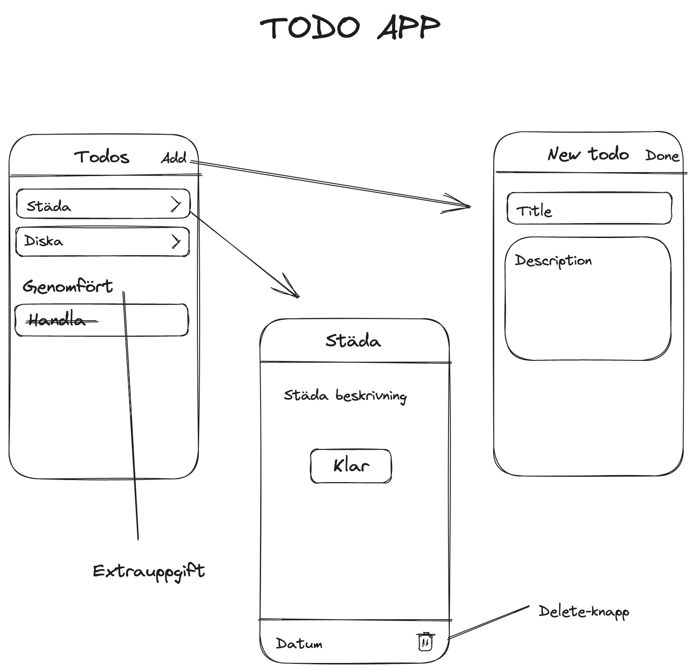

# Todo-app i React Native med Expo Router

Bygg en todo-app där du övar på navigering och delat state med **Expo Router**.



## Kom igång

Skapa ett Expo-projekt med standardmallen, som innehåller Expo Router och TypeScript:

```bash
npx create-expo-app@latest todo-app
cd todo-app
npx expo start
```

Du kan köra `npm run reset-project` innan du börjar för att ta bort mallens exempelskärmar. Se [Expos startguide](https://docs.expo.dev/tutorial/create-your-first-app/) om du behöver hjälp med installationen.

## Hur du klarar uppgiften

1. Använd Expo Router med en stack och tre skärmar: **Home**, **Detail** och **Add**.
2. **Home:** Visa dina todos med `FlatList`. Ett tryck på en todo ska öppna dess detaljsida.
3. **Detail:** Visa vald todo och låt användaren markera den som genomförd/ej genomförd eller ta bort den.
4. **Add:** Öppna som en modal där användaren kan lägga till en todo eller avbryta. Tomma titlar ska inte gå att spara.
5. Ändringar ska synas när användaren återvänder till Home. Todo-listan ska behållas mellan skärmarna, men behöver inte sparas efter omstart.

## Tips på vägen

- **Låt filerna beskriva navigationen.** Läs om [routes och layouts](https://docs.expo.dev/router/basics/core-concepts/) och fundera på hur en dynamisk route kan representera en detaljsida.
- **Skicka ett ID, inte hela todon eller funktioner.** Läs om [route-parametrar](https://docs.expo.dev/router/reference/url-parameters/) och hämta aktuell todo från ditt delade state.
- **Tänk igenom var state ska finnas.** Alla tre skärmar behöver samma lista. [React Context](https://react.dev/learn/passing-data-deeply-with-context) kan vara ett sätt att dela den. Uppdatera listan utan att mutera state och ge varje todo ett stabilt, unikt ID.
- **Använd en modal-route för Add.** Se [Expos modalguide](https://docs.expo.dev/router/advanced/modals/).
- **Tänk på användaren.** Prova `Pressable` för tryckbara rader. Visa tydliga tomma lägen och hantera en todo som inte längre finns. Kontrollera att tangentbordet inte täcker formuläret.

Testa hela flödet på Android eller iOS: lägga till, avbryta, öppna detaljer, ändra status, ta bort och gå tillbaka.

## Automatiska tester

Använd det medföljande [testpaketet](tests/README.md) och lägg till de `testID` som testerna behöver. Kör `npm run test:assignment` under arbetet. Testerna kontrollerar appens beteende, och GitHub Actions kör även en TypeScript-kontroll vid push.

## VG-uppgift

- Visa genomförda todos i en egen sektion med `SectionList`.
- Spara todos lokalt så att de finns kvar efter omstart.
